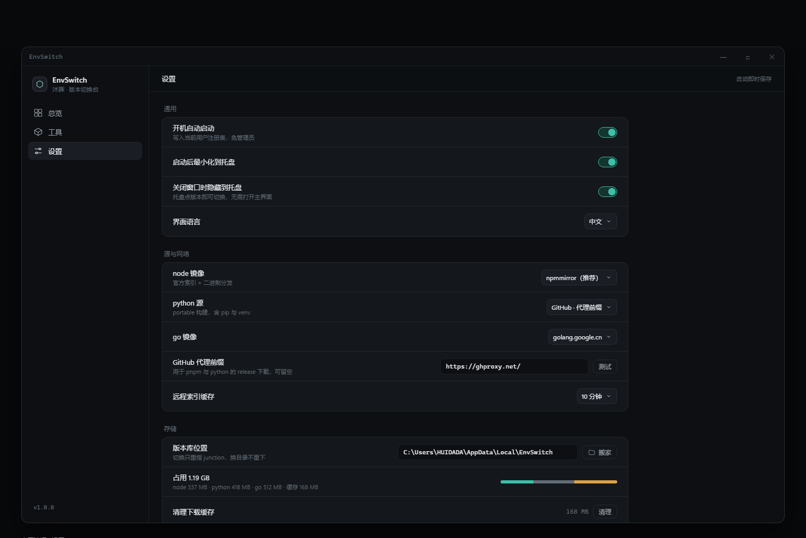

<p align="center"></p>

# EnvSwitch

Windows 上的开发环境版本管理桌面应用。把 node、python、go、java 等工具的版本统一收进独立版本库，界面上点一下就切换，不写系统 PATH，不需要管理员权限。

MIT 协议 · 作者 [沐晖](https://github.com/HUIdada1)

## 界面

下面是设计稿，实际界面按它实现：

| 总览 | 工具详情 |
|------|----------|
|  |  |
| **设置** | **托盘菜单** |
|  |  |

浏览器打开 [design/index.html](design/index.html) 可以看完整交互注记。

## 要解决的事

装了 nvm、scoop，又手动装过 node，PATH 里谁胜出全凭运气；新机器配环境，每个工具各下一遍，国内网络还经常超时；项目 A 要 node 16，项目 B 要 node 22，来回敲 `nvm use` 还容易失效；卸载一个版本比安装还麻烦。

EnvSwitch 的做法是独立版本库加 junction 重指向。切换就是毫秒级改一个目录链接，PATH 只在首次启用时写入一次，之后不再动。

## 它怎么工作

所有东西都在 `%LOCALAPPDATA%\EnvSwitch`：

- `store\<工具>\<版本>` 放各个版本的实际文件
- `current\<工具>` 是指向当前版本的 junction，切换只改这个链接
- `bin\shims` 放自动生成的 npm / pnpm / yarn 等命令入口，永远指向稳定路径

PATH 里只插入五条：`current\node`、`current\python`、`current\go`、`bin\shims`，以及 `envs.exe` 所在目录。因为链接路径不变，切换版本不需要改注册表。已打开的终端不会变，新开的终端立即用新版本，这是 Windows 环境块的机制，不是 bug。

只有 node、python、go 和 npm / npx / pnpm / pnpx / yarn 会被自动接进 PATH。其余工具装完能管能切，但命令行要自己补一条 `current\<工具>`，一次加好之后切版本不用再动 —— 细节在[使用说明书](docs/使用说明书.md)。

安装走同一条流水线：选源下载、断点续传、哈希校验、解包落位、跑一遍版本号冒烟。npm 系包用 registry 的 `dist.integrity` 校验，node 和 python 用官方哈希。主源挂了会自动试备用源，哈希不对则直接失败删件。

对 nvm-windows 这类外部管理器只读：它能识别并列出 nvm 装过的版本，直接切过去，零下载，但不会删别人的目录。

## 支持的工具

共 17 个，按界面里的分组：

- **语言运行时**：node.js、python、Go、Rust、PHP、Deno、Bun
- **包管理与工具链**：npm、pnpm、yarn classic、uv
- **企业运行时 (JVM/.NET)**：JDK (Temurin)、Maven、Gradle、.NET SDK
- **云原生与运维**：kubectl、Terraform

每个工具各自管理版本、镜像源和缓存，互不牵连。node / npm / pnpm / yarn 默认走 npmmirror，Go 默认 golang.google.cn，python 默认先探 GitHub 不通自动退 NJU 镜像，Maven 可切阿里云。前四个能在设置页直接切，python / go / maven 用 `envs config set mirror.<工具> <源>`，见 [使用说明书 §9](docs/使用说明书.md)。

## 安装

从 [Releases](https://github.com/HUIdada1/EnvSwitch/releases) 取用：

| 文件 | 用途 |
|------|------|
| `EnvSwitch-Setup-vX.Y.Z.exe` | 安装版，per-user 装到 `%LOCALAPPDATA%\Programs\EnvSwitch`，免管理员 |
| `EnvSwitch-win-x64.zip` | 免安装，解压即用（含 `EnvSwitch.exe` 与 `envs.exe`） |
| `SHA256SUMS.txt` | 上面那个 zip 的校验值 |

装完先跑这三条：

```powershell
envs install node 22.22.0   # 下载 → 哈希校验 → 解包 → 跑一遍 --version
envs use node 22            # 切换（毫秒级重指 junction），顺带首次写入 PATH
envs doctor                 # 体检：PATH 顺序、链接健康、共存冲突、WebView2
```

完整操作手册（界面导览、每个设置项的含义、数据搬家、镜像与代理、故障排查、已知限制）见 **[docs/使用说明书.md](docs/使用说明书.md)**。各版本改了什么见 [releases/](releases/) 目录与 [Releases 页面](https://github.com/HUIdada1/EnvSwitch/releases)。

## 命令行

CLI 是 `envs.exe`，和 GUI 共用同一套核心逻辑。常用命令：

```
envs status                     各工具当前版本、来源，以及 PATH 里实际胜出的是谁
envs list node                  已安装版本（--remote 看可装的，--filter 18 过滤）
envs use node 22.22.0           切换；也支持前缀和 latest
envs install pnpm@9.12.3        安装；无激活版本时装完自动切上
envs remove go 1.22.5           卸载（--cascade 允许删当前激活版本）
envs which node                 当前实际生效的可执行文件全路径
envs doctor                     体检：PATH 顺序、链接健康、权限、共存冲突、WebView2
envs autostart on|off|status    开机自启（HKCU Run）
envs config show                查看全部配置
envs config set mirror.node official
envs path ensure|restore        写入或移除 EnvSwitch 的 PATH 条目
envs clean                      清理下载缓存，不动已装版本
envs gui                        打开桌面应用
envs self update|rollback       自更新或回滚到上一版
```

`status`、`list`（本机分支）、`doctor`、`config show`、`version` 支持 `--json`，方便脚本调用。退出码：0 成功 / 1 失败或未找到 / 2 参数用法错 / 3 网络 / 4 校验失败 / 5 权限。

## 桌面端

GUI 基于 Wails v2 + Vue 3，窗口自绘标题栏，关闭默认缩到托盘（可在设置里改成退出）。托盘右键菜单按工具列出已装版本，点一下就切，不用开主界面。开机自启走 HKCU Run，同样不需要管理员权限。

更新机制是自替换：下载带哈希校验，旧 exe 改名 `.old`，新文件落位后带 `--updated` 重启。新进程 5 秒内写出 heartbeat 才算更新成功，否则启动时自动回滚。也可以手动 `envs self rollback`。

## 构建

需要 Go 1.22+、Node 16+、Wails v2。Windows 上直接用附带的 PowerShell 脚本：

```powershell
.\build.ps1           # 同时构建 CLI 和 GUI
.\build.ps1 -Cli      # 只构建 envs.exe
.\build.ps1 -Gui      # 只构建 EnvSwitch.exe
```

产物在 `build\bin\`。手动构建的话，先 `cd frontend && npm install && npm run build`，因为 GUI 的 Go 代码会 embed `frontend/dist`；然后 `go build ./cmd/envs` 出 CLI，`go build -tags production -ldflags "-H=windowsgui" -o build\bin\EnvSwitch.exe .` 出 GUI（不需要装 wails 命令行）。版本号通过 `-X github.com/HUIdada1/envswitch/internal/core.Version=vX.Y.Z` 注入。

前端单独开发用 `wails dev`，有热更新。

## 文档

- [使用说明书](docs/使用说明书.md) —— 面向使用者：安装卸载、界面与托盘、命令行全表、配置项、数据搬家、镜像与代理、故障排查、已知限制
- [架构方案](docs/架构方案.md) —— 选型依据、切换机制、安装流水线、更新协议、里程碑
- [设计语言](docs/设计语言.md) —— 色板、栅格、组件规范，前端 token 的唯一来源

## 许可

MIT © 2026 沐晖
