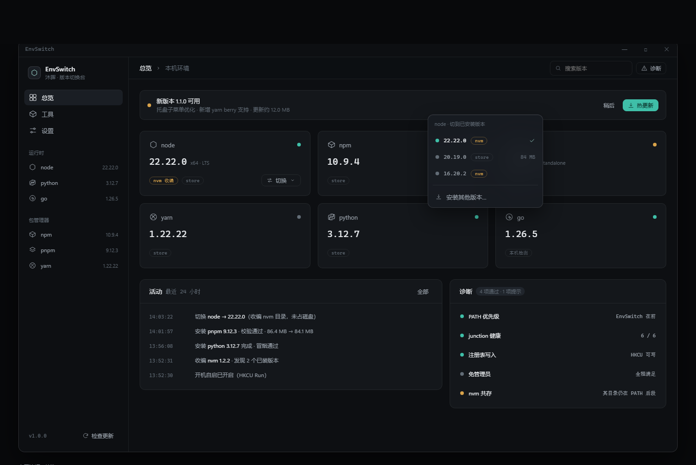
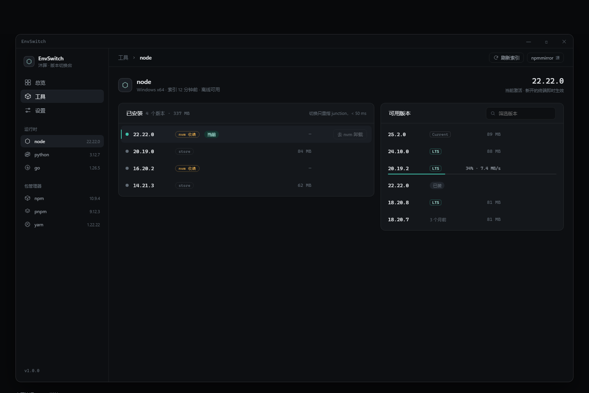
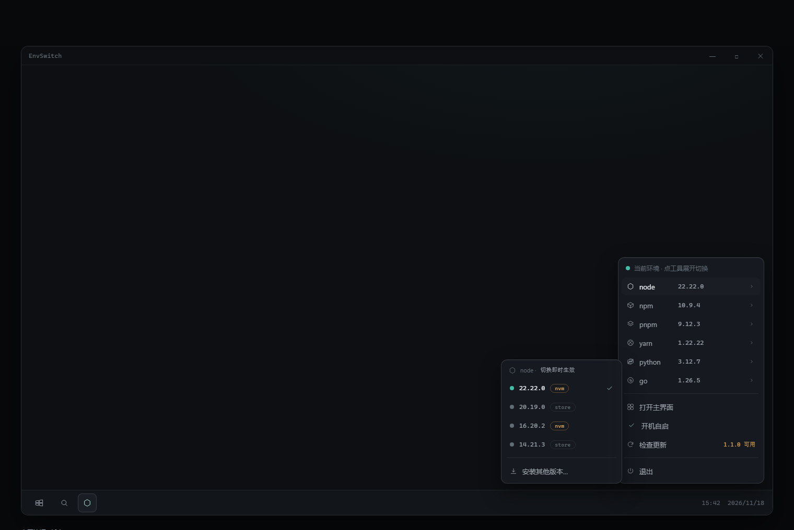

<p align="center"></p>

# EnvSwitch

Windows 上的开发环境版本管理桌面应用。把 node、python、go、java 等工具的版本统一收进独立版本库，界面上点一下就切换，不写系统级 PATH，不需要管理员权限。

MIT License + 附加使用条款（复合授权）· 作者 [沐晖](https://github.com/HUIdada1)

> 下载、安装或使用前，请先完整阅读[使用声明](#使用声明)与 [License](#license)。本项目**不是纯粹的 MIT 项目**。

## 界面

下面是设计稿，实际界面按它实现：

| 总览 | 工具详情 |
|------|----------|
|  |  |
| **设置** | **托盘菜单** |
|  |  |

浏览器打开 [design/index.html](design/index.html) 可以看完整交互注记。

## 要解决的事

装了 nvm、scoop，又手动装过 node，PATH 里谁胜出全凭运气；新机器配环境，每个工具各下一遍，国内网络还经常超时；项目 A 要 node 16，项目 B 要 node 22，来回敲 `nvm use` 还容易失效；卸载一个版本比安装还麻烦。

EnvSwitch 的做法是独立版本库加 junction 重指向。切换就是毫秒级改一个目录链接，PATH 只在首次启用时写入一次，之后不再动。

## 它怎么工作

所有东西都在 `%LOCALAPPDATA%\EnvSwitch`：

- `store\<工具>\<版本>` 放各个版本的实际文件
- `current\<工具>` 是指向当前版本的 junction，切换只改这个链接
- `bin\shims` 放自动生成的 npm / pnpm / yarn 等命令入口，永远指向稳定路径

PATH 里只插入五条：`current\node`、`current\python`、`current\go`、`bin\shims`，以及 `envs.exe` 所在目录。因为链接路径不变，切换版本不需要改注册表。已打开的终端不会变，新开的终端立即用新版本，这是 Windows 环境块的机制，不是 bug。

只有 node、python、go 和 npm / npx / pnpm / pnpx / yarn 会被自动接进 PATH。其余工具装完能管能切，但命令行要自己补一条 `%LOCALAPPDATA%\EnvSwitch\current\<工具>`，一次加好之后切版本不用再动。

安装走同一条流水线：选源下载、断点续传、哈希校验、解包落位、跑一遍版本号冒烟。npm 系包用 registry 的 `dist.integrity` 校验，node 和 python 用官方哈希。主源挂了会自动试备用源，哈希不对则直接失败删件。

对 nvm-windows 这类外部管理器只读：它能识别并列出 nvm 装过的版本，直接切过去，零下载，但不会删别人的目录。

## 支持的工具

共 22 个，按界面里的分组：

- **语言运行时**：node.js、python、Go、Rust、PHP、Deno、Bun
- **包管理与工具链**：npm、pnpm、yarn classic、pip、nvm-windows、uv、Git
- **企业运行时 (JVM/.NET)**：JDK (Temurin)、Maven、Gradle、.NET SDK
- **云原生与运维**：Docker、kubectl、Terraform、Redis

其中 pip 随 Python 解释器分发、nvm-windows 的 node 版本归它自己所有，这两项只做本机检测与只读收编；其余工具都会下载进版本库并可切换。

每个工具各自管理版本、镜像源和缓存，互不牵连。node / npm / pnpm / yarn 默认走 npmmirror，Go 默认 golang.google.cn，python 默认先探 GitHub 不通自动退 NJU 镜像，Maven 可切阿里云。前四个能在设置页直接切，python / go / maven 用 `envs config set mirror.<工具> <源>`。

## 安装

从 [Releases](https://github.com/HUIdada1/EnvSwitch/releases) 取用：

| 文件 | 用途 |
|------|------|
| `EnvSwitch-Setup-vX.Y.Z.exe` | 安装版，per-user 装到 `%LOCALAPPDATA%\Programs\EnvSwitch`，免管理员 |
| `EnvSwitch-win-x64.zip` | 免安装，解压即用（含 `EnvSwitch.exe`、`envs.exe`、`LICENSE`、`THIRD-PARTY-NOTICES.md`） |
| `SHA256SUMS.txt` | 上面那个 zip 的校验值 |

> 安装包与便携包内均附 `LICENSE` 与 `THIRD-PARTY-NOTICES.md`。下载、安装或使用即表示你已阅读并同意其中的条款；不同意请不要使用。

装完先跑这三条：

```powershell
envs install node 22.22.0   # 下载 → 哈希校验 → 解包 → 跑一遍 --version
envs use node 22            # 切换（毫秒级重指 junction），顺带首次写入 PATH
envs doctor                 # 体检：PATH 顺序、链接健康、共存冲突、WebView2
```

各版本改了什么见 [releases/](releases/) 目录与 [Releases 页面](https://github.com/HUIdada1/EnvSwitch/releases)。

## 命令行

CLI 是 `envs.exe`，和 GUI 共用同一套核心逻辑。常用命令：

```
envs status                     各工具当前版本、来源，以及 PATH 里实际胜出的是谁
envs list node                  已安装版本（--remote 看可装的，--filter 18 过滤）
envs use node 22.22.0           切换；也支持前缀和 latest
envs install pnpm@9.12.3        安装；无激活版本时装完自动切上
envs remove go 1.22.5           卸载（--cascade 允许删当前激活版本）
envs which node                 当前实际生效的可执行文件全路径
envs doctor                     体检：PATH 顺序、链接健康、权限、共存冲突、WebView2
envs autostart on|off|status    开机自启（HKCU Run）
envs config show                查看全部配置
envs config set mirror.node official
envs path ensure|restore        写入或移除 EnvSwitch 的 PATH 条目
envs clean                      清理下载缓存，不动已装版本
envs gui                        打开桌面应用
envs self update|rollback       自更新或回滚到上一版
```

`status`、`list`（本机分支）、`doctor`、`config show`、`version` 支持 `--json`，方便脚本调用。退出码：0 成功 / 1 失败或未找到 / 2 参数用法错 / 3 网络 / 4 校验失败 / 5 权限。

## 桌面端

GUI 基于 Wails v2 + Vue 3，窗口自绘标题栏，关闭默认缩到托盘（可在设置里改成退出）。托盘右键菜单按工具列出已装版本，点一下就切，不用开主界面。开机自启走 HKCU Run，同样不需要管理员权限。

更新机制是自替换：下载带哈希校验，旧 exe 改名 `.old`，新文件落位后带 `--updated` 重启。新进程 5 秒内写出 heartbeat 才算更新成功，否则启动时自动回滚。也可以手动 `envs self rollback`。

## 构建

需要 Go 1.22+、Node 16+、Wails v2。Windows 上直接用附带的 PowerShell 脚本：

```powershell
.\build.ps1           # 同时构建 CLI 和 GUI
.\build.ps1 -Cli      # 只构建 envs.exe
.\build.ps1 -Gui      # 只构建 EnvSwitch.exe
```

产物在 `build\bin\`。手动构建的话，先 `cd frontend && npm install && npm run build`，因为 GUI 的 Go 代码会 embed `frontend/dist`；然后 `go build ./cmd/envs` 出 CLI，`go build -tags production -ldflags "-H=windowsgui" -o build\bin\EnvSwitch.exe .` 出 GUI（不需要装 wails 命令行）。版本号通过 `-X github.com/HUIdada1/envswitch/internal/core.Version=vX.Y.Z` 注入。

前端单独开发用 `wails dev`，有热更新。

## 帮助

- `envs --help` / `envs <command> --help`：命令行全部用法
- [Issues](https://github.com/HUIdada1/EnvSwitch/issues)：问题反馈
- [Releases](https://github.com/HUIdada1/EnvSwitch/releases)：版本说明与下载

## 使用声明

> 请在使用本项目前完整阅读本节。**下载、安装、启动或以任何方式使用本项目，即视为你已阅读、理解并全部接受以下条款。**

### 一、项目性质与无关联声明

EnvSwitch 是一个运行在你自己电脑上的开发环境版本管理器，用于把 node、python、go、java 等工具的多个版本收进本地版本库并快速切换。它以源码形式公开，供学习、研究与个人使用，**不是任何公司的官方产品或官方工具**。

本项目与下列公司及其产品**均无任何关联**，未获得其授权、认可、赞助或背书：

OpenJS Foundation 及 Node.js，npm, Inc. 及 npm / npx，Microsoft 及 Windows / .NET / WebView2，Python Software Foundation 及 Python，Google 及 Go，Rust Foundation 及 Rust，PHP Group 及 PHP，Eclipse Foundation 及 Temurin / Adoptium，Apache Software Foundation 及 Maven，Gradle, Inc. 及 Gradle，HashiCorp 及 Terraform，CNCF / Linux Foundation 及 kubectl，Deno Land 及 Deno，Oven 及 Bun，Astral 及 uv，以及 pnpm、Yarn（Meta）等其他在文档、代码或界面中提及的工具提供方。

文中出现的所有产品名、工具名、商标、协议名与服务名均归其各自所有者，仅用于标识与说明用途，不构成任何形式的关联或授权。EnvSwitch **不包含、不重新分发、也不托管这些工具本体**：它只从各工具的官方或镜像下载源取得安装包，按校验值核验后落位到本地版本库，工具本身仍按其原始许可使用。

### 二、禁止用途

禁止将本项目用于：

- **任何商业用途**：企业内部生产环境、对外提供收费服务、作为商业产品的一部分、承接商业项目交付、收费的安装部署与培训
- **二次分发牟利**：打包售卖、付费镜像、以本项目换取赞助、广告或流量分成、付费下载或代安装
- **改名换皮**：改名后作为另一款产品发布，或使他人误认为你的版本是官方版本、经作者认可
- **去除署名**：删除、模糊或篡改版权声明、作者署名、产品名称、logo，以及「关于」面板与安装程序中展示的署名
- **冒充官方更新源**：把自更新清单、下载地址或安装包指向自建站点冒充官方来源，或分发经篡改的更新包
- **绕过完整性校验**：移除、伪造或绕过下载内容的哈希校验、版本号核验，或日后可能引入的代码签名
- **训练模型**：未经书面许可，将源代码用于训练、微调或评估任何机器学习模型
- **违法用途**：违反当地法律法规，或侵害他人计算机系统、网络与数据安全

上述禁止事项同时写入 [LICENSE](./LICENSE) 第二部分的「附加使用条款」，构成本项目授权与使用约定的一部分，**不是仅作呼吁**；违反者属超出授权范围，作者保留主张权利的一切权利。

如需在生产环境或商业场景中使用，请先通过 1439078547@qq.com 或 [GitHub](https://github.com/HUIdada1) 联系作者取得书面授权。

### 三、环境操作与数据风险

EnvSwitch 会真实改动你的系统环境和磁盘内容，请在使用前理解这一点：

- 首次启用会向**用户级 PATH**（`HKCU\Environment`）写入五条路径，并在 `%LOCALAPPDATA%\EnvSwitch` 下创建版本库、junction 与 shim；`envs path restore` 会移除这些条目
- `envs use` 重指向 junction，`envs remove` 删除版本目录，`envs clean` 清空下载缓存，`envs self update` 会替换正在运行的 exe
- 哈希校验只能保证「下载到的内容与上游发布的一致」，不能保证上游本身可信；主源与备用源均为第三方托管
- 已打开的终端不会随切换改变，新开终端才生效 —— 这是 Windows 环境块的机制，不是故障
- 与 nvm-windows、scoop 等外部管理器共存时只读识别，不删它们的目录，但 PATH 顺序可能互相影响，用 `envs doctor` 诊断
- 杀毒软件可能对「下载可执行文件 + 修改 PATH + 自替换 exe」的组合行为报警，请自行判断来源
- 卸载程序**不会删除** `%LOCALAPPDATA%\EnvSwitch`，需要彻底清除请自行删除该目录
- 因环境损坏、版本误删、PATH 冲突、下载源投毒或误操作造成的任何损失，**由使用者自行承担，作者不承担任何责任**

在生产机、CI 机器或任何不可逆的环境中，请先备份并自行验证。

### 四、无担保与权利通知

本项目按「现状」（AS IS）提供，作者**不对其可用性、稳定性、安全性、兼容性或对特定用途的适用性作任何明示或默示的承诺与保证**。

- 各工具的下载地址、镜像源、版本命名与安装包结构随时可能变更，本项目可能随时失效且不再维护，作者无更新、修复或答疑的义务
- 使用本项目造成的任何直接或间接损失（包括但不限于环境损坏、数据丢失、业务中断、第三方索赔、监管处罚），**作者一概不承担任何责任**
- 若权利方认为本项目对其名称、商标或下载源的使用存在不当之处，请联系作者，将及时调整或删除

**完整条款见 [LICENSE](./LICENSE)。** 若你不同意本节任何一条，请立即停止使用并删除本项目及其相关数据。

## License

本项目采用 **[MIT License](./LICENSE) + 附加使用条款** 的**复合授权**，**不是纯粹的 MIT 项目**：

| 部分 | 内容 |
| --- | --- |
| 第一部分 · MIT License | 授予软件层面的使用、复制、修改、合并、发布、分发、再许可与销售权利 |
| 第二部分 · 附加使用条款 | 对本项目的使用场景作进一步限制：禁止商业用途、禁止二次分发牟利、禁止改名换皮冒充官方、禁止去除署名、禁止冒充官方更新源、禁止绕过完整性校验、禁止用于模型训练、禁止违法用途 |

两部分**不可分割**，共同构成本项目完整的授权与使用约定；仅接受其中一部分者，不得以任何形式使用、复制、修改或分发本项目。附加条款与上文[使用声明](#使用声明)第二节「禁止用途」一致，如表述有出入以 [LICENSE](./LICENSE) 为准。

商业场景使用须事先联系作者另行取得书面授权（1439078547@qq.com 或 [GitHub](https://github.com/HUIdada1)）。第三方组件许可与商标归属见 [THIRD-PARTY-NOTICES.md](./THIRD-PARTY-NOTICES.md)。

Copyright (c) 2026 沐晖 (Muhui)
